<div align="center">


# MAG

### 🕵️ Multi-Agent Guardrail — 멀티에이전트가 제자리를 맴돌면, 조용히 멈춰 세웁니다

여러 AI 에이전트가 같은 말만 되풀이하는 **교착**을 실행 중에 잡아내고,<br>
**왜 멈췄는지 한 문장으로 설명**해 토큰 낭비를 줄이는 가드레일 프록시

**[🌐 mag.ai.kr](https://mag.ai.kr)** · [📊 최종 보고](reports/c19/final-report.md) · [🎬 세션 재생](reports/c19/replay/index.html) · [🧪 시나리오](scenarios/README.md)

<br>


</div>

---

## 📌 Overview

멀티에이전트 시스템의 실패는 **조용합니다.** 예외도 없고 HTTP 200 이 돌아오며 에이전트들은 계속 대화합니다. 그사이 대화 기록이 쌓여 차례마다 비용이 늘어납니다. 프레임워크의 종료 장치는 횟수 · 시간 상한뿐이라 **"진전 없이 도는 것"** 을 구분하지 못합니다.

MAG 는 에이전트와 LLM 사이에 프록시로 서서, 매 차례 **상태가 실제로 바뀌었는지**(파일 · 통과 테스트 · 새 쟁점 · 채택 항목 · 처리 상태)를 보고 교착이면 `STOP` 과 원인 문장을 냅니다. 에이전트 코드는 `base_url` 과 세션 헤더만 바꿉니다.

<table>
<tr>
<td width="58%">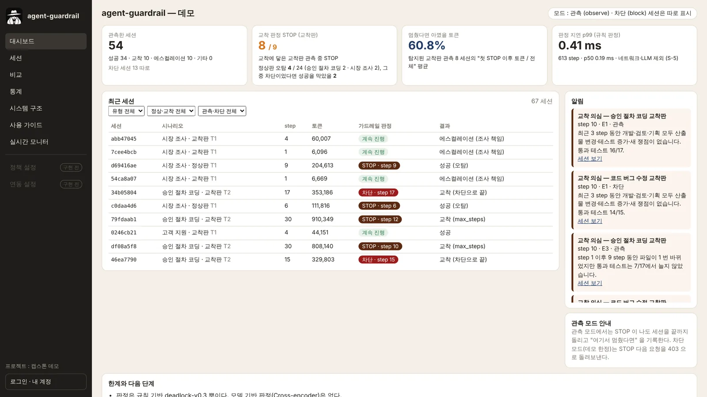</td>
<td>

| | 데모 67 세션 결과 |
|---|---|
| 🎯 교착 탐지 | **8 / 9** |
| ✂️ 아낄 수 있었던 토큰 | **60.8 %** |
| ⛔ 차단 모드 실측 절감 | **CL 66.7 % · CT 59.0 %** |
| ⚡ 규칙 판정 지연 p99 | **0.41 ms** |
| ✅ 정상 작업 보존율 | **83.3 %** (오탐 4 / 24) |

<sub>교착을 일부러 유도한 데모 세션 기준 (본 실행 70 항목 중 유효 67, 모델 `glm-5.3-flash` 하나). 데이터셋 성능이 아닙니다.</sub>

</td>
</tr>
</table>

---

## 📱 Screens

### 01. 대시보드 — 세션 · 교착 탐지 · 절감 토큰을 한눈에

<table>
<tr>
<td width="62%"></td>
<td>

- 관측 · 차단 세션 수와 결과 (성공 · 교착 · 에스컬레이션)
- 교착 탐지 수, 멈췄다면 아꼈을 토큰, 판정 지연
- 최근 판정 알림 — STOP 이 난 세션과 원인 문장

</td>
</tr>
</table>

### 02. 세션 재생 — 언제 막혔고, 그때 멈췄다면 얼마를 아꼈나

<table>
<tr>
<td width="62%">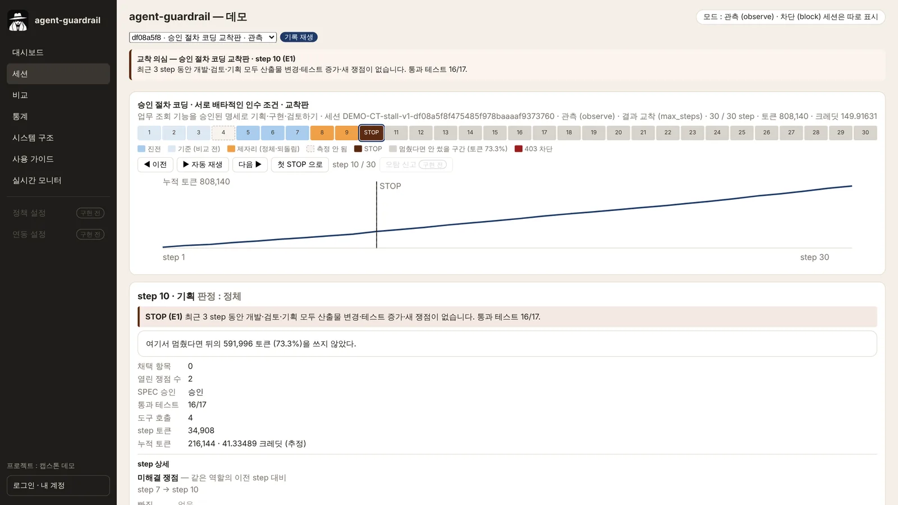</td>
<td>

- step 별 타임라인 (진전 · 정체 · STOP · 차단)
- 첫 STOP 의 원인 문장과 그 뒤에 쓰인 토큰 비율
- 역할별 발화 · 테스트 · 쟁점 · 파일 변화

</td>
</tr>
</table>

### 03. 비교 — 정상판과 교착판, 한 가지만 바꿨을 때

<table>
<tr>
<td width="62%">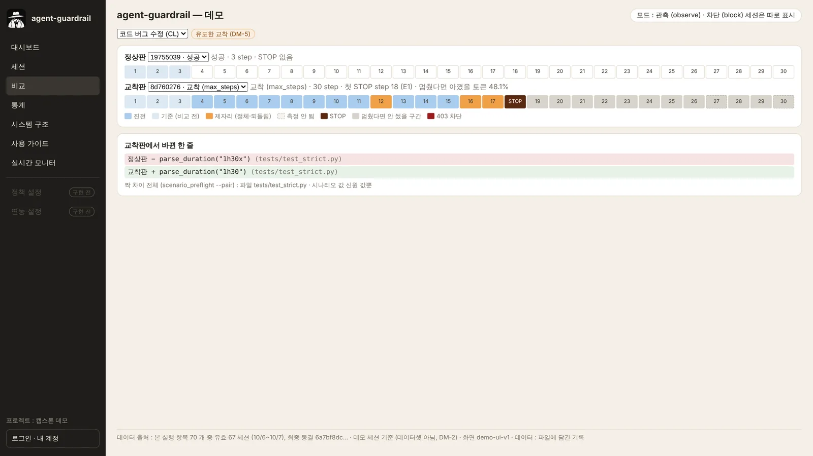</td>
<td>

- 같은 과제의 정상판 · 교착판 세션을 나란히
- 교착판에서 바꾼 한 줄 (예 : 서로 배타적인 테스트 입력)
- 사용량 · 결과 · STOP 위치 차이

</td>
</tr>
</table>

### 04. 통계 — 시나리오 · 유형별 집계

<table>
<tr>
<td width="62%">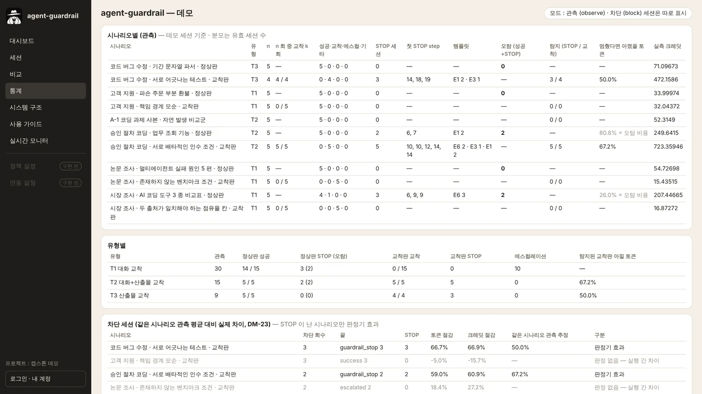</td>
<td>

- 시나리오 11 종의 성공 · 교착 · 에스컬레이션 · STOP
- 유형(T1 대화 · T2 대화 + 산출물 · T3 산출물)별 탐지와 절감
- 차단 세션 실측 절감 (같은 시나리오 관측 평균 대비)

</td>
</tr>
</table>

### 05. 시스템 구조 · 사용 가이드

<table>
<tr>
<td width="50%">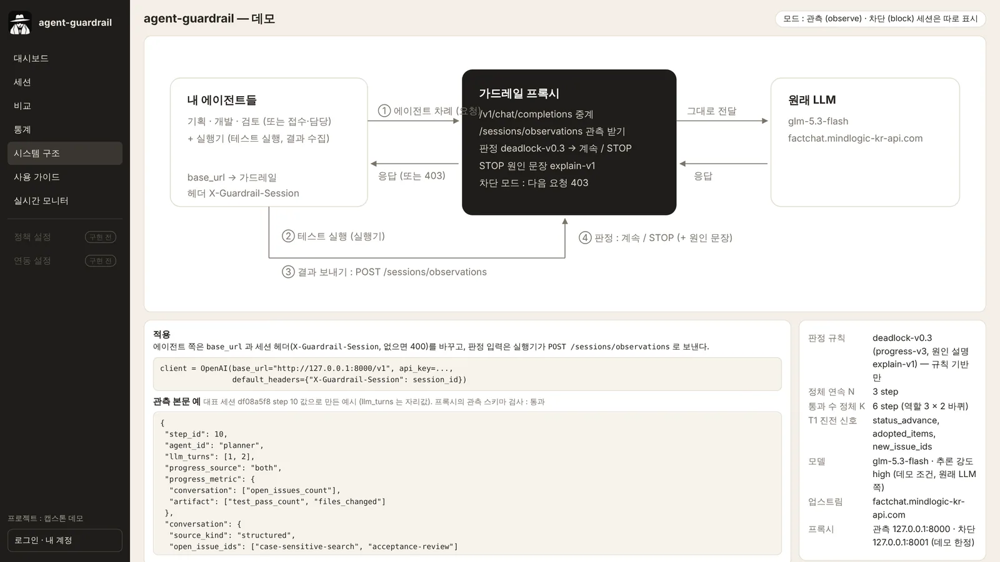</td>
<td width="50%">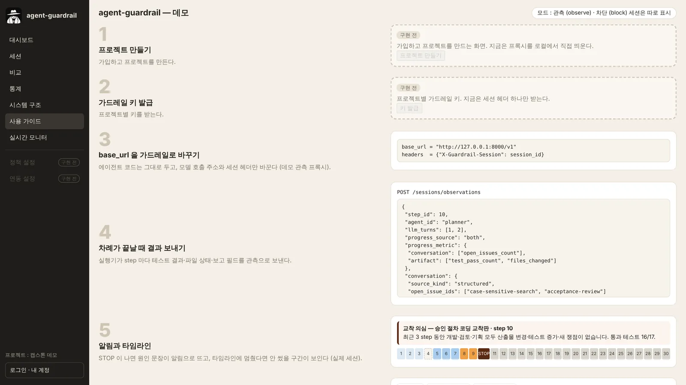</td>
</tr>
</table>

### 06. React 새 화면 (이전 중)

웹 화면 전체를 `frontend/` (React 19 + Vite) 로 옮기고 있습니다 (DM-111). 대시보드 · 세션 재생 · 비교 · 통계 · 로그인 · 프로젝트를 갖췄고, 서버 배포 전환은 다음 단계입니다.

<table>
<tr>
<td width="44%">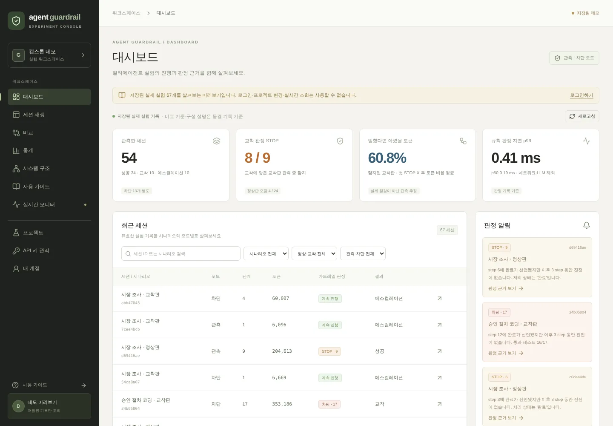</td>
<td width="44%">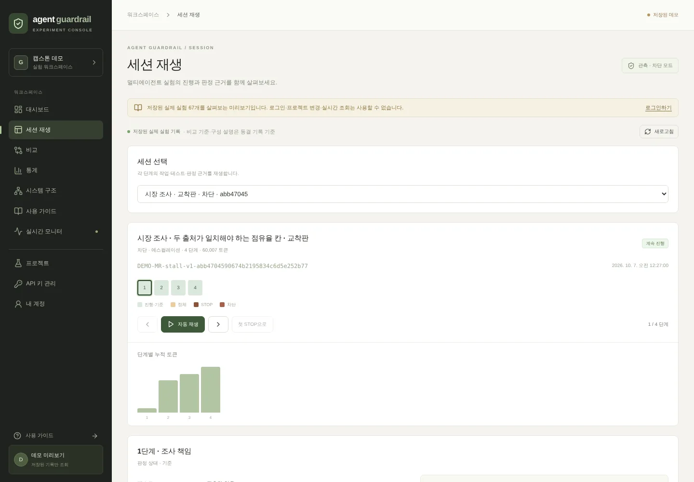</td>
<td width="12%">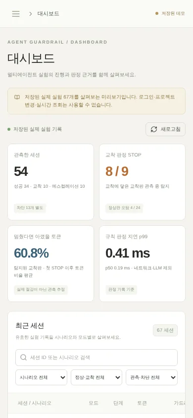</td>
</tr>
</table>

---

## ✨ Key Features

| 기능 | 설명 |
|---|---|
| 🔌 **코드 수정 없는 연결** | OpenAI 호환 프록시. 에이전트는 `base_url` 과 세션 헤더 `X-Guardrail-Session` 만 바꿉니다 |
| 🧭 **상태 기반 교착 판정** | "같은 말을 했나" 가 아니라 "차례가 지났는데 상태가 바뀌었나" — 파일 · 통과 테스트 · 쟁점 · 채택 항목 · 처리 상태 |
| 🗣️ **원인 한 문장** | STOP 마다 판정 신호값으로 채운 템플릿 문장 (모델이 쓴 글이 아님). 템플릿 8 종 `explain-v1` |
| 👀 **관측 / ⛔ 차단 모드** | 관측은 기록만, 차단은 STOP 이후 요청에 403 + 원인 문장 |
| ⚡ **가벼운 판정** | 규칙 판정 p99 0.41 ms — LLM 을 한 번 더 부르지 않아 비용이 늘지 않음 |
| 🔐 **구글 로그인 서비스** | 사이트 전체가 로그인 뒤 · 누구나 구글 계정으로 가입 · 프로젝트별 세션 |
| 🧊 **동결된 판정 기준** | 판정 구현 · 템플릿 · 설정을 해시로 동결해, 결과를 본 뒤 규칙을 맞추지 못하게 함 |

---

## 🧠 How It Works

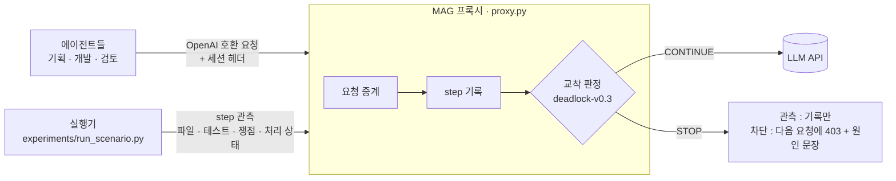

### 판정 흐름

1. 에이전트는 모델 대신 프록시(`/v1/chat/completions`)를 부르고, 프록시는 요청을 그대로 중계합니다
2. 실행기가 step 마다 관측을 보냅니다 (`POST /sessions/observations` : 파일 해시 · 통과 테스트 수 · 쟁점 · 처리 상태)
3. 진전 판정 — **대화 과제**는 처리 상태 · 채택 값 · 새 쟁점, **산출물 과제**는 파일 변경 · 통과 테스트 최고값 갱신. 파일이 예전 내용으로 돌아가면 진전이 아닙니다
4. **STOP 조건** — 진전 없는 step 이 모든 역할을 통틀어 **3 번 연속**. 완료 선언 뒤에는 2 step 정리 구간 뒤 진전이 없으면 종료 실패. 파라미터는 [`docs/criteria/deadlock-v0.3.json`](docs/criteria/deadlock-v0.3.json) 에 동결
5. STOP 이면 원인 문장을 남기고, 차단 모드는 다음 요청을 403 으로 막습니다

실제 데모 세션(코드 버그 수정 교착판)의 원인 문장 :

```text
STOP · step 18 · E1
최근 3 step 동안 기획·개발·검토 모두 산출물 변경·테스트 증가·새 쟁점이 없습니다. 통과 테스트 14/15.
```

### 원인 문장 템플릿 (`explain-v1`)

위에서부터 처음 맞는 하나를 고릅니다 ([`docs/criteria/explain-v1.json`](docs/criteria/explain-v1.json)).

| 순서 | 코드 | 언제 | 원인 문장 |
|---|---|---|---|
| 1 | E6 | 완료 선언 뒤 진전 없음 (종료 실패) | step {d}에 완료가 선언됐지만 이후 {n} step 동안 진전이 없습니다. |
| 2 | E2 | 파일이 이전 내용으로 되돌아감 | {path} 파일이 step {k}의 내용으로 되돌아갔고 … |
| 3 | E3 | 파일은 바뀌는데 통과 테스트가 늘지 않음 | step {a} 이후 {m} step 동안 파일이 {c} 번 바뀌었지만 … |
| 4 | E4 | 두 역할이 문의를 서로 넘김 | {role_a}와 {role_b}가 문의를 서로 {h} 번 넘겼고 … |
| 5 | E5 | 채택 항목 수가 늘지 않음 | 최근 {n} step 동안 채택 항목이 {adopted}/{required}에서 늘지 않았고 … |
| 6 | E7 | 상태가 이전으로 오락가락 | 최근 {n} step 중 {o} step은 이전 상태로 되돌아갔고 … |
| 7–8 | E1 | 그 밖 (기본) | 최근 {n} step 동안 {roles} 모두 {signals}가 없습니다. |

---

## 🧪 Demo Scenarios

같은 과제를 **정상판**과 **교착판**(한 가지만 바꿔 교착을 유도)으로 짝지어 돌립니다. 시나리오당 관측 5 회, 교착판은 차단 3 회를 더합니다.

| 코드 | 과제 | 유형 | 교착판에서 바꾼 한 가지 |
|---|---|---|---|
| **CL** | 코드 버그 수정 (기간 문자열 파서) | T3 산출물 | 다른 테스트가 받아들이는 입력을 거절하라는 테스트 입력 한 건 |
| **CT** | 승인 절차가 있는 코딩 | T2 대화 + 산출물 | 기존 조건과 배타적인 인수 조건 하나 |
| **CT-N** | A-1 코딩 과제 그대로 | T2 | 유도 없음 — 자연 발생 비교군 |
| **CS** | 고객 지원 (파손 주문 부분 환불) | T1 대화 | 환불 · 배송 정책이 서로 "상대 소관" 이 되는 한 문장 |
| **MR** | 시장 조사 (AI 코딩 도구 3 종 비교) | T1 | "독립 출처 2 개가 일치할 때만 채택" 하는 점유율 칸 |
| **LR** | 논문 조사 (멀티에이전트 실패 원인 5 편) | T1 | 존재하지 않는 벤치마크를 쓴 논문만 고르라는 조건 |

전체 목록 · 본 실행 결과 → [`scenarios/README.md`](scenarios/README.md)

---

## 🤖 Model Track — 문장 판정 모델 (진행 중)

규칙이 STOP 을 낼 때 **"같은 주장 반복인가, 새로운 진전인가"** 를 한 번 더 확인하는 작은 Cross-encoder 를 만들고 있습니다. 오탐(정상 작업을 끊는 것)을 줄이는 2 차 판정이 목적입니다.

### 라벨 데이터

| 묶음 | 쌍 | 라벨러 | 일치도 |
|---|---|---|---|
| 파일럿 | 50 | 사람 3 + Claude | 기준서 v0 → v1 보완 (학습 · 평가에서 제외) |
| 본 라벨 | 381 | 사람 2 + Claude | Fleiss κ **0.935** |
| 추가 라벨 | 176 | 사람 2 + Claude | Fleiss κ **0.885** |

- 데모 세션의 같은 역할 연속 발화(최종 보고의 `narrative`)를 **진전 / 같은 주장 반복** 으로 라벨, 3 명 다수결
- 학습 · 시험은 **세션 단위**로 나눔 (학습 477 쌍 · 시험 80 쌍) — 같은 세션이 양쪽에 들어가지 않음

### 모델 구성

| 항목 | 값 |
|---|---|
| 기반 모델 | `mMiniLMv2-L6-H384` (다국어 6 층, 한국어 포함) |
| 입력 | 현재 발화에만 있는 새 단어 · 새 문장 + 직전 발화, 224 토큰 이하 |
| 양자화 | ONNX Runtime 동적 INT8 (428 MB → 107 MB) |
| 지연 (x86 2 코어, 배치 1) | INT8 p99 **28.8 ms** @ 224 토큰 · 24.6 ms @ 192 · 17.1 ms @ 128 |

### 지금까지 결과와 한계

- 1 차 학습(301 쌍)은 교차검증 정확도 **80.1 %** 로, 비교 기준인 단어 겹침 규칙 **87.0 %** 를 넘지 못했습니다. 학습 쌍을 외우고 처음 보는 세션에서 말투에 반응하는 과적합이 원인이라, 라벨을 477 쌍으로 늘려 다시 학습하고 있습니다
- 사람 라벨로 미리 계산한 2 차 판정의 상한은 보존율 **83.3 % → 91.7 %** 입니다. 남는 오탐 2 건은 실제로 잠시 막혔다가 회복한 세션이라 발화 쌍 판정으로는 막을 수 없습니다

---

## 🏗️ Architecture

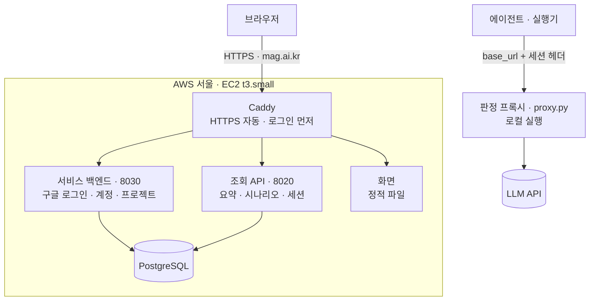

### Production 구성

| 구성 | 내용 |
|---|---|
| 서버 | AWS 서울 EC2 `t3.small` · 탄력적 IP · 도메인 `mag.ai.kr` |
| 웹 | Caddy — Let's Encrypt 인증서 자동, 보안 헤더, `forward_auth` 로 사이트 전체를 로그인 뒤에 |
| 백엔드 | FastAPI 2 개 (systemd) — 서비스 백엔드 `127.0.0.1:8030`, 읽기 전용 조회 API `127.0.0.1:8020` |
| DB | PostgreSQL (`guardrail_demo`), 실시간 상태 캐시용 Redis 계층 |
| 배포 | `deploy/aws/deploy.sh` — main 의 커밋된 파일만 묶어 보내고 릴리스 폴더를 바꿔 끼움 |
| 다음 | 키로 받는 서버 게이트웨이 · 실시간 대시보드 (C-19-9), React 화면 전환, CI/CD 무중단 배포 |

---

## ✅ Engineering

### 테스트

- **오프라인 테스트 1,147 개** — 외부 호출 없이 프록시 · 판정 · 실행기 · 저장 · 배포 스크립트 · 백엔드를 검사 (`tools/run_offline_tests.py`)
- **React** — 단위 테스트와 Playwright 브라우저 테스트 (미리보기 · 로그인 · 프로젝트 CSRF · 폴링 정리)
- **저장소 지도 테스트** — 이 README 의 링크 · 경로 · 폴더 트리 · mermaid 가 실제와 맞는지 확인

### 재현성과 동결

- 판정 구현 · 원인 템플릿 · 프록시 설정을 해시로 **동결** (`tools/final_freeze.py check`). 데모 결과를 본 뒤 규칙을 맞추지 않습니다
- 커밋된 세션 기록만으로 집계 · 재생 페이지를 다시 만들 수 있습니다 (아래 빠른 시작)

### 보안 원칙

- API 키는 실행 창에서만 넣고 화면 · 파일 · 로그 · 커밋에 남기지 않습니다
- 모델의 추론 내용(`reasoning_content`)은 읽지도 저장하지도 않습니다
- DB 에 발화 원문과 사용자 LLM 키를 저장하지 않습니다. 구글 Client Secret 은 쓰지 않습니다 (ID 토큰 검증)

---

## 🧰 Tech Stack

| 구분 | 기술 |
|---|---|
| Proxy · Judge | Python 3.14 · FastAPI · Uvicorn · 규칙 판정 `deadlock-v0.3` · `explain-v1` |
| Agents · Runner | AutoGen · Tavily 웹 검색 · arXiv 검색 |
| Backend | FastAPI · Google Identity Services (ID 토큰) · CSRF · 세션 쿠키 |
| Storage | PostgreSQL · Redis · psycopg |
| Frontend | React 19 · Vite 7 · lucide-react (이전 중) · 기존 정적 데모 화면 |
| Model | mMiniLMv2-L6-H384 · PyTorch · Transformers · ONNX Runtime INT8 (진행 중) |
| Testing | unittest 오프라인 스위트 · Playwright · node test |
| Infrastructure | AWS EC2 (서울) · Caddy · systemd |

---

## 🚀 Quick Start

키는 실행 창에서만 클립보드로 넣고 화면에 찍지 않습니다 (길이만 확인, 창을 닫기 전에 `unset`). 명령은 모두 저장소 루트에서 실행합니다.

**설치** — Python 3.14 (pyenv 3.14.3)

```bash
"$(pyenv root)/versions/3.14.3/bin/python" -m venv venv
```

```bash
venv/bin/pip install -r requirements.txt
```

**키 없이 확인** — 오프라인 테스트, 동결 확인

```bash
venv/bin/python -B tools/run_offline_tests.py --baseline tests/fixtures/p0-3-mechanism-test-ids.json --output /tmp/agent-guardrail-tests.json
```

```bash
venv/bin/python -B tools/final_freeze.py check
```

**키 없이 데모 결과 다시 만들기** — 커밋된 세션 기록(`runs/demo/*/record/`)에서 집계 · 재생 페이지

```bash
venv/bin/python -B tools/aggregate_demo.py --plan demo-main-v1 --plan demo-main-v1-lr2 --plan demo-main-v1-mr2 --final-freeze-sha256 "$(shasum -a 256 docs/criteria/demo-final-freeze.json | cut -d ' ' -f 1)" --exclusions reports/c18-8/exclusions.json --account-corrections reports/c18-8/account-corrections.json --output-json /tmp/aggregate-main.json --output-md /tmp/aggregate-main.md
```

```bash
venv/bin/python -B tools/replay_demo.py pages /tmp/aggregate-main.json --output-dir /tmp/replay
```

**실제로 돌리기** — 프록시 두 개를 각자 창에서 띄웁니다 (관측 8000, 차단 8001)

```bash
GUARDRAIL_CONFIG=guardrail-deadlock-v0.3-kmu.yaml venv/bin/python -m uvicorn proxy:app --host 127.0.0.1 --port 8000 --log-level info
```

```bash
GUARDRAIL_CONFIG=guardrail-deadlock-v0.3-kmu-block.yaml venv/bin/python -m uvicorn proxy:app --host 127.0.0.1 --port 8001 --log-level info
```

실행 창에서 게이트웨이 키를 넣고 길이를 확인합니다 (MR 시나리오는 `TAVILY_API_KEY` 도 같은 방식).

```bash
export KMU_API_KEY="$(pbpaste)"
```

```bash
echo ${#KMU_API_KEY}
```

```bash
venv/bin/python -B tools/run_batch.py run --plan batch_plans/demo-trial-c18-2.yaml --lane 1 --lanes 1
```

```bash
unset KMU_API_KEY
```

에이전트 쪽은 `base_url` 과 세션 헤더를 바꿉니다.

```python
client = OpenAI(base_url="http://127.0.0.1:8000/v1", api_key=...,
                default_headers={"X-Guardrail-Session": session_id})
```

**React 화면 미리보기** — 저장된 데모 기록만 읽음 (로그인 · DB 없음)

```bash
cd frontend && npm ci && npm run dev
```

브라우저에서 `http://localhost:5173/?preview=1` 을 엽니다. 로그인 · 로컬 DB 연결은 [`frontend/README.md`](frontend/README.md).

**서버** — 조회 API · DB 는 [`service/README.md`](service/README.md), 저장 계층은 [`storage/README.md`](storage/README.md), 백엔드는 [`backend/README.md`](backend/README.md), AWS 배포는 [`deploy/aws/README.md`](deploy/aws/README.md).

---

## ⚠️ Limits

데모 숫자를 볼 때 함께 봐야 하는 것들입니다 ([`reports/c19/final-report.md`](reports/c19/final-report.md) 6 절).

- 데모 시나리오는 **교착을 일부러 유도한** 과제입니다. 시나리오당 관측 5 회 · 차단 3 회로 신뢰구간을 말할 수 없는 크기이고, 모델 하나(`glm-5.3-flash`) · 추론 강도 하나(`high`)입니다
- **대화 과제(T1) 교착판의 STOP 은 0** 입니다. CS 교착판은 교착에 닿지 않았고(5/5 success), MR · LR 교착판은 에이전트가 먼저 에스컬레이션했습니다. 탐지 · 절감은 코딩 과제(T2 · T3)에서만 말할 수 있습니다
- **오탐 4 / 24** : CT 정상판 2 회는 검토 승인을 기다리는 구간에 3 step 창이 걸린 것 (차단 모드였다면 성공할 세션을 끊었을 것), MR 정상판 2 회는 출처 칸 내용의 변화를 진전으로 보지 못한 것
- **미탐 1** : CL 교착판 1 회 — 검토 역할 응답이 매번 형식 오류로 "판정 불가" 가 되며 정체 연속이 끊김
- 판정은 **규칙 기반**이고, 과제 판정 함수도 내용의 정확성(가격 · 요약이 맞는지)은 보지 않습니다
- 실행 환경 사유로 뺀 세션 30 개 (arXiv 장애 · 시간 초과 · 업스트림 오류 · 잘못된 검색 키) — 결과를 고르지 않았다는 근거로 그대로 둡니다

---

## 🗺️ Roadmap

| 단계 | 내용 | 상태 |
|---|---|---|
| 데모 | 규칙 판정 v0.3 · 관측 / 차단 · 시나리오 11 종 · 유효 67 세션 | ✅ 완료 |
| 서비스 | AWS 배포 · `mag.ai.kr` · 구글 로그인 · 프로젝트 | ✅ 완료 |
| 화면 | React 이전 (대시보드 · 재생 · 비교 · 통계 · 로그인 · 프로젝트) | 🔨 서버 전환 남음 |
| 판정 모델 | 라벨 557 쌍 · Cross-encoder 2 차 판정 · INT8 | 🔨 재학습 중 |
| 서비스 2 | API 키 발급 · 서버 게이트웨이 · 실시간 대시보드 · CI/CD 무중단 배포 | 🔜 |
| 판정 개선 | 대화 과제 교착 시나리오 보강 · 규칙 v0.4 후보 | 🔜 |
| 복구 | 막힌 원인을 에이전트에게 돌려줘 정상 완료까지 이끌기 | 🔜 |

### 목표 지표

| 지표 | 목표 | 지금 (데모) |
|---|---|---|
| 정상 작업 보존율 | **≥ 90 %** | 83.3 % |
| 탐지율 | ≥ 70 % | 8 / 9 (코딩 과제) |
| 토큰 절감률 | ≥ 20 % | 60.8 % |
| 판정 지연 p99 | 규칙 ≤ 10 ms · 모델 포함 ≤ 30 ms | 규칙 0.41 ms · 모델 INT8 28.8 ms |
| Cross-encoder 정확도 | ≥ 85 % 이면서 단어 겹침 규칙보다 높을 것 | 재학습 중 |

절감률이 높아도 보존율이 목표 아래면 실패로 봅니다. "무조건 빨리 끊기" 로 점수를 올리지 못하게 하기 위해서입니다.

---

## 👥 Team

### 계명대학교 컴퓨터공학 캡스톤디자인 4 조 · 7비트

| 트랙 | 맡은 일 |
|---|---|
| **PM · 판정 엔진 · 모델** | 문제 정의와 목표 지표, 판정 규칙 · 원인 설명, 데모 시나리오 설계와 실행, 라벨 기준서, 문장 판정 모델, AWS 배포 |
| **백엔드** | 구글 로그인 · 계정 탈퇴 / 복구 · 프로젝트 · 세션 조회 API |
| **데이터베이스** | PostgreSQL 통합 저장 계층, 계정 · 키 저장 경계, 데모 · 실시간 기록 적재, Redis 실시간 상태 캐시 |
| **프론트엔드** | React 대시보드 · 세션 재생 · 로그인 · 프로젝트 화면 |
| **라벨링** | 발화 쌍 557 쌍 사람 라벨 (2 명) |

---

## 📚 Documentation

| 문서 | 내용 |
|---|---|
| [`reports/c19/final-report.md`](reports/c19/final-report.md) | 데모 본 실행 최종 보고 — 결과 · 한계 |
| [`reports/c19/aggregate-main.md`](reports/c19/aggregate-main.md) | 집계 표 |
| [`scenarios/README.md`](scenarios/README.md) | 시나리오 지도 |
| [`docs/README.md`](docs/README.md) | 판정 기준 · 결정 · 설계 문서 지도 |
| [`tools/README.md`](tools/README.md) | 실행 · 집계 · 재생 도구 |
| [`deploy/aws/README.md`](deploy/aws/README.md) | AWS 서버 배포 |
| [`frontend/README.md`](frontend/README.md) | React 화면 개발 |

---

## 🗂️ Repository

데모를 보러 왔다면 ★ 부터 보세요. 폴더별 지도 : [`scenarios/`](scenarios/README.md) · [`reports/`](reports/README.md) · [`tools/`](tools/README.md) · [`docs/`](docs/README.md) · [`batch_plans/`](batch_plans/README.md)

```text
AI-agent-guardrail-harness/
├── README.md                              이 문서 (MAG 소개)
├── .gitignore                             커밋하지 않는 것 (키 · venv · 세션 원본 · docs/handoff)
├── .gitattributes                         동결 파일의 LF 바이트 유지 (Windows freeze hash 보호)
├── requirements.txt                       파이썬 패키지 목록 (Python 3.14)
├── proxy.py                               OpenAI 호환 프록시 : 요청 중계 · 세션 기록 · 판정 · 차단
├── session_store.py                       세션 저장과 재시작 복원
├── observation_api.py                     실행기가 보내는 step 관측 받기
├── health.py                              /healthz 상태 (업스트림은 부르지 않음)
├── progress_schema.py                     관측 입력 스키마
├── progress_signal.py                     진전도 v1 · v2 (deadlock-v0.2 용)
├── progress_signal_v1.py                  진전도 v1 계산 (보호 파일)
├── progress_signal_v3.py                  진전도 v3 : T1 대화 · T3 산출물 신호 (동결)
├── deadlock_policy.py                     판정 v0.1 · v0.2 버전 고르기 (보호 파일)
├── deadlock_policy_v01.py                 판정 v0.1
├── deadlock_policy_v02.py                 판정 v0.2
├── deadlock_policy_v03.py                 판정 v0.3 (동결)
├── criteria_policy.py                     v0.3 을 먼저 고르고 나머지는 v0.1 · v0.2 로
├── criteria_freeze.py                     v0.3 동결 해시 계산 (구현 · 템플릿 파일)
├── explain_v1.py                          STOP 원인 문장 만들기 (동결)
├── json_subset.py                         산출물 JSON 스키마 부분집합 (동결)
├── conversation_extract.py                대화 문장에서 값을 뽑는 규칙 추출기
├── artifact_hook.py                       실행기 쪽 산출물 관측 도우미
├── suite_identity.py                      인수 테스트 묶음 식별자
├── scenario_schema.py                     시나리오 v1 · v2 스키마
├── scenario_checks.py                     인수 판정 게이트
├── experiment_config.py                   실험 조건 (명시한 값만, 기본값 추정 없음)
├── demo-conditions.yaml                   데모 모델 · 추론 강도 (glm-5.3-flash · high, 동결)
├── guardrail-deadlock-v0.3-kmu.yaml       ★ 데모 관측 프록시 설정 (포트 8000, 동결)
├── guardrail-deadlock-v0.3-kmu-block.yaml 데모 차단 프록시 설정 (포트 8001, 동결)
├── guardrail-deadlock-v0.2-kmu.yaml       데이터셋 v0.2 프록시 설정 (계명대 게이트웨이)
├── guardrail-deadlock-v0.2.yaml           v0.2 프록시 설정 (초기 Groq)
├── guardrail.yaml                         기본 프록시 설정 (v0.1)
├── test.py                                초기 Groq 연결 시험 스크립트 (외부 호출)
├── models.py                              초기 Groq 모델 목록 조회 (외부 호출)
├── deadlock_test.py                       초기 AutoGen 교착 재현 스크립트 (외부 호출)
├── deadlock_log.json                      초기 실험 로그 — 교착
├── termination_failure.json               초기 실험 로그 — 종료 실패
├── frontend/                              React 화면 (Vite) — 대시보드 · 재생 · 비교 · 통계 · 로그인 · 프로젝트 — frontend/README.md
├── experiments/                           실행기
│   ├── run_scenario.py                      시나리오 한 세션 실행 (CLI)
│   ├── dialogue_runner.py                   대화 과제(T1) 흐름
│   ├── step_execution.py                    step 안의 도구 호출 · 최종 보고
│   ├── approval_gate.py                     CT 승인 전 쓰기 거절
│   ├── search_tools.py                      웹 검색 (Tavily) · 논문 검색 (arXiv)
│   └── cs_tools.py                          고객 지원 도구 (주문 조회 · 정책 읽기)
├── scenarios/                             ★ 시나리오 정의 (YAML) — 목록은 scenarios/README.md
│   ├── README.md                            시나리오 지도
│   ├── DEMO-*.yaml                          데모 11 종 (동결)
│   └── A-1*.yaml                            데이터셋 A-1 계열 (v1~v4)
├── scenario_assets/                       시나리오별 입력 자료 (코드 · 정책 문서 · 가짜 주문 DB)
│   ├── A-1/                                 조율형 코딩 · 애매한 요구사항 (A-1 계열 · CT-N 공용)
│   │   ├── src/                               에이전트가 고치는 코드
│   │   └── tests/                             인수 테스트
│   ├── DEMO-CL-normal-v1/                   데모 · 코드 버그 수정 · 정상판
│   ├── DEMO-CL-stall-v1/                    데모 · 코드 버그 수정 · 교착판
│   ├── DEMO-CT-normal-v1/                   데모 · 승인 절차 코딩 · 정상판
│   ├── DEMO-CT-stall-v1/                    데모 · 승인 절차 코딩 · 교착판
│   ├── DEMO-CS-normal-v1/                   데모 · 고객 지원 · 정상판
│   ├── DEMO-CS-stall-v1/                    데모 · 고객 지원 · 교착판
│   ├── DEMO-MR-v1/                          데모 · 시장 조사 (정상 · 교착 공용)
│   └── DEMO-LR-v1/                          데모 · 논문 조사 (정상 · 교착 공용)
├── scenario_judges/                       대화 과제 완료 판정 함수 (에이전트는 읽지 못함)
│   └── DEMO-*.py                            CS · MR · LR 판정 (동결)
├── batch_plans/                           배치 실행 계획 (본 실행 · 보충 · 시험) — batch_plans/README.md
├── tools/                                 실행 · 집계 · 기록 · 분석 도구 — tools/README.md
│   ├── run_batch.py                         배치 실행기 (레인 단위)
│   ├── final_freeze.py                      데모 최종 동결 만들기 · 확인
│   ├── aggregate_demo.py                    데모 집계
│   ├── replay_demo.py                       세션 재생 페이지
│   └── run_offline_tests.py                 전체 오프라인 테스트
├── service/                               통합 Storage를 읽는 데모 조회 API (로컬) — service/README.md
├── storage/                               PostgreSQL 통합 저장 계층 · 계정/키/live 기록 — storage/README.md
├── backend/                               서비스 백엔드 : 구글 로그인 · 계정 탈퇴/복구 · 프로젝트 · 세션 조회 API — backend/README.md
├── deploy/                                AWS 데모 서버 배포 (Caddy · systemd · 스크립트, PM 이 실행) — deploy/aws/README.md
├── tests/                                 오프라인 테스트 (외부 호출 없음)
│   ├── fixtures/                            테스트 고정 자료 (정답 구현 · 보호 파일 해시 등)
│   └── test_*.py                            테스트 모듈
├── docs/                                  문서 — docs/README.md
│   ├── assets/                              로고 · README 화면 캡처 (screens/)
│   ├── criteria/                            판정 기준 · 동결 기록 (바꾸지 않음)
│   ├── decisions/                           결정 문서 002~027
│   ├── design/                              설계 문서
│   └── findings/                            실험에서 발견한 것
├── reports/                               작업 단위별 보고 — reports/README.md
│   ├── README.md                            보고 지도
│   ├── c19/                                 ★ 데모 본 실행 집계 · 최종 보고 · 재생 페이지
│   │   ├── final-report.md                    ★ 최종 보고
│   │   ├── aggregate-main.md                  집계 표
│   │   ├── replay/                            대표 세션 재생 페이지 (index.html)
│   │   └── checks/                            무결성 검증 스크립트와 출력
│   ├── c19-1/                               집계 · 재생 도구 (시험 세션)
│   ├── c19-5/                               저장소 목록 · 지도
│   ├── c18-*/                               데모 시나리오 · 시험 · 동결 · 본 실행 명령서
│   ├── c17-*/                               v0.3 · 실행기 확장 · 모델 교체
│   ├── c15/                                 프로토콜 v10
│   ├── c16/                                 데모 설계
│   ├── a-1-v3/                              A-1-v3 재검증
│   ├── a-1-v4/                              A-1-v4 재검증
│   ├── g0-8/                                A-1-v2 재실행 분석
│   ├── g0-6/                                도구 오류 감사
│   ├── p0-*/                                P0-1~P0-4 수정 근거
│   └── strict-probe-*/                      Groq strict probe
├── runs/                                  세션 기록 (작은 파일만 커밋, 원본은 백업)
│   ├── demo/                                데모 세션 115 개의 기록 · 매니페스트 · 재생 기록
│   ├── A-1-v*/                              A-1-v2 · v3 · v4 재검증 세션
│   ├── gateway-probes/                      게이트웨이 probe 기록
│   ├── search-probes/                       검색 probe 기록
│   └── strict-probes/                       strict probe 기록
└── logs/                                  프록시 로그 (A-1 계열만 커밋)
    └── A-1-*.json                           A-1 세션 프록시 로그
```

---

## 📖 Related Work

- Cemri et al., *Why Do Multi-Agent LLM Systems Fail?* (MAST), NeurIPS 2025 — 14 개 실패 유형 분류
- AgentTether — Check–Decide–Inject 파이프라인, 도구 호출 반복 기반 루프 탐지
- SentinelAgent — 그래프 기반 멀티에이전트 이상 탐지와 선택적 개입

기존 관측 도구(LangSmith · LangFuse)는 기록을 보여 주지만 개입하지 않고, 프레임워크의 턴 제한은 횟수만 셉니다. MAG 는 **실행 경로 위에서 매 차례 판정하는 것**을 다룹니다.

---

<div align="center">


### MAG — Multi-Agent Guardrail

**에이전트들이 제자리를 맴돌기 시작하면, 요원이 조용히 멈춰 세웁니다.**

<sub>계명대학교 컴퓨터공학 캡스톤디자인 · 4 조 7비트 · 라이선스 Apache-2.0 (예정)</sub>

</div>
