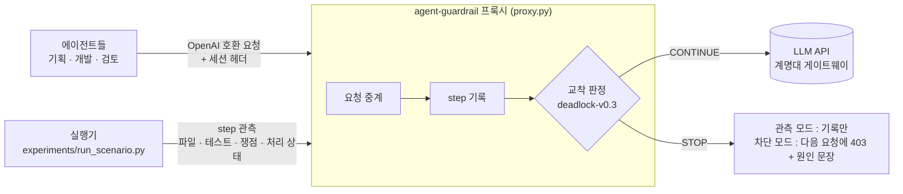

<div align="center">


# agent-guardrail

**에이전트들이 제자리를 맴돌기 시작하면, 요원이 조용히 멈춰 세웁니다.**

멀티에이전트 LLM 세션의 교착을 실행 중에 판정하는 프록시 하네스

에이전트 프레임워크 코드 수정 없음 · 모델 호출은 `base_url` 과 세션 헤더만 바꿈 · 관측 / 차단 모드

<br>


</div>

---

## 한눈에 보기

> 교착을 일부러 유도한 **데모 세션 67 개** 기준입니다 (본 실행 70 항목 중 유효 67, 모델 `glm-5.3-flash` 하나). 데이터셋 성능이 아닙니다.

| | 결과 | 무엇을 셌나 |
|---|---|---|
| 🎯 **교착 탐지** | **8 / 9** | 교착판 관측 세션 중 실제로 교착에 닿은(미완료) 9 개에서 STOP 이 난 수 (CL 3/4 · CT 5/5). 미탐 1 (CL) |
| ✂️ **아낄 수 있었던 토큰** | **60.8 %** | 탐지된 8 세션의 "첫 STOP 이후 토큰 / 세션 전체 토큰" 평균 (CT 67.2 % · CL 50.0 %) |
| ⛔ **차단 모드 실측 절감** | **CL 66.7 % · CT 59.0 %** | STOP 이 난 차단 세션(CL 3 · CT 2)의 평균 토큰을 같은 시나리오 관측 평균과 비교 (관측 추정 CL 50.0 % · CT 67.2 % 와 나란히) |
| ⚠️ **정상판 오탐** | **4 / 24** | 성공한 정상판 세션에서 난 STOP (CT 2 · MR 2). 그중 **2 회**는 차단 모드였다면 성공 전에 끊겼을 세션 (둘 다 CT : STOP step 7 / 성공 24, STOP 6 / 성공 27) |
| 💳 **실측 비용** | **2,209.69 크레딧** | 유효 67 세션 합계 (게이트웨이 실측). 제외된 30 세션의 실측 333.61 은 별도 |

**대화 과제(T1) 교착판의 STOP 은 0 입니다.** CS 교착판은 교착에 닿지 않았고(5/5 success), MR · LR 교착판은 에이전트가 먼저 에스컬레이션했습니다. 판정기가 실제로 잡은 것은 T2 · T3 교착입니다.

자세한 결과와 한계 → [`reports/c19/final-report.md`](reports/c19/final-report.md) · 세션 재생 → [`reports/c19/replay/index.html`](reports/c19/replay/index.html)

---

## 문제 — 조용한 실패

멀티에이전트 시스템은 자주 실패하고, 그 실패는 조용합니다.

예외도 없고 HTTP 200 이 돌아오며 에이전트는 계속 대화합니다. 그동안 대화 기록이 쌓여 차례마다 비용이 늘어납니다. 사람이 로그를 읽지 않으면 알아챌 방법이 없습니다.

초기 자체 실험(대화형 2 세션, 인수인계 2026-09-15 이전, Groq)에서 본 세 가지 유형입니다. 로그는 [`deadlock_log.json`](deadlock_log.json) · [`termination_failure.json`](termination_failure.json).

| 유형 | 현상 | 낭비율 |
|---|---|---|
| **교착** | 합의에 닿지 못한 채 같은 주장이 반복됨 | 84.9 % |
| **종료 실패** | 합의한 뒤에도 세션이 끝나지 않음 | 69.1 % |
| **빈 응답** | HTTP 200 인데 `content` 가 공백, 토큰은 과금 | 19 턴 중 13 턴 |

세 유형 모두 **도구 호출 0 회** 상태에서 일어났습니다. 도구 호출 반복을 세는 기존 방식으로는 잡히지 않습니다.

---

## 어떻게 동작하나



- 에이전트는 모델을 직접 부르지 않고 프록시(`/v1/chat/completions`)를 부릅니다. 바꾸는 것은 `base_url` 과 세션 헤더 `X-Guardrail-Session` 입니다
- 판정에 쓰는 상태(파일 해시 · 통과 테스트 수 · 쟁점 · 처리 상태)는 **실행기가 step 마다 관측으로 보냅니다** (`POST /sessions/observations`). 지금은 이 저장소의 실행기(`experiments/run_scenario.py`, AutoGen)가 그 역할을 합니다
- 판정 대상은 "같은 말을 반복했는가" 가 아니라 **"차례가 지났는데 상태가 바뀌었는가"** 입니다
  - **대화 과제** (고객 지원 · 조사) — 처리 상태, 채택한 값, 새 쟁점이 움직였는가
  - **산출물 과제** (코딩) — 파일이 바뀌었는가, 통과 테스트가 세션 최고값을 넘었는가
  - **되돌림** — 파일이 예전 내용으로 돌아오면 변화가 있어도 진전이 아닙니다
- **STOP 조건** : 진전 없는 step 이 모든 역할을 통틀어 **3 번 연속** (`consecutive_steps: 3`, 역할마다 첫 관측은 기준). 완료 선언 뒤에는 2 step 의 정리 구간(`grace_steps: 2`)을 준 다음 진전이 없으면 종료 실패로 봅니다. 파라미터는 [`docs/criteria/deadlock-v0.3.json`](docs/criteria/deadlock-v0.3.json) 에 동결돼 있습니다

STOP 이 나면 사람이 읽을 수 있는 **원인 문장**을 함께 남깁니다. 판정 신호값만으로 채운 템플릿 문장이고, 모델이 쓴 글이 아닙니다. 실제 데모 세션(CL 교착판 `8d760276`)의 예 :

```text
STOP · step 18 · E1
최근 3 step 동안 기획·개발·검토 모두 산출물 변경·테스트 증가·새 쟁점이 없습니다. 통과 테스트 14/15.
```

### 판정 템플릿 (`explain-v1`)

STOP 이 나면 위에서부터 처음 맞는 템플릿 하나를 고릅니다 ([`docs/criteria/explain-v1.json`](docs/criteria/explain-v1.json) 의 `selection_order`). 템플릿에 필요한 값이 없으면 다음 줄로 넘어가고, "(측정 안 됨)" 은 마지막 E1 에서만 씁니다.

| 순서 | 코드 | 언제 | 원인 문장 (템플릿) |
|---|---|---|---|
| 1 | E6 | 완료가 선언됐는데 그 뒤로 진전이 없음 (종료 실패) | step {d}에 완료가 선언됐지만 이후 {n} step 동안 진전이 없습니다. 통과 테스트 {pass}/{total}. |
| 2 | E2 | 정체 구간 안에서 파일이 이전 내용으로 되돌아감 | {path} 파일이 step {k}의 내용으로 되돌아갔고, 통과 테스트는 {m} step 동안 {pass}/{total}입니다. |
| 3 | E3 | 정체 구간 안에서 파일은 바뀌는데 통과 테스트가 늘지 않음 (6 step) | step {a} 이후 {m} step 동안 파일이 {c} 번 바뀌었지만 통과 테스트는 {pass}/{total}에서 늘지 않았습니다. |
| 4 | E4 | 두 역할이 문의를 서로 4 번 이상 넘김 (대화 과제) | {role_a}와 {role_b}가 문의를 서로 {h} 번 넘겼고 처리 상태는 '{status}'에서 바뀌지 않았습니다. |
| 5 | E5 | 채택 항목 수가 늘지 않음 (채택 항목을 고른 대화 과제) | 최근 {n} step 동안 채택 항목이 {adopted}/{required}에서 늘지 않았고 처리 상태는 '{status}'입니다. |
| 6 | E7 | 정체 구간 안에서 상태가 이전으로 되돌아감 (오락가락) | 최근 {n} step 중 {o} step은 이전 상태로 되돌아갔고, 나머지는 변화가 없었습니다. |
| 7 | E1-T1 | 그 밖 — 테스트 관측이 없는 대화 과제 | 최근 {n} step 동안 {roles} 모두 {signals}가 없습니다. 처리 상태 '{status}'. |
| 8 | E1 | 그 밖 — 기본 문장 | 최근 {n} step 동안 {roles} 모두 {signals}가 없습니다. 통과 테스트 {pass}/{total}. |

조사(이/가, 과/와)는 앞 낱말의 받침에 맞춰 고릅니다. 대화 과제의 E6 은 끝 구절이 "처리 상태는 '{status}'입니다." 입니다.
데모 본 실행에서 실제로 나온 템플릿은 E1 · E3 · E6 입니다 ([`reports/c19/final-report.md`](reports/c19/final-report.md) 3-2 절).

### 모드

| 모드 | 동작 | 상태 |
|---|---|---|
| `observe` | 판정만 기록, 응답은 그대로 | ✅ 동작 |
| `block` | STOP 이후 요청에 403 + 원인 문장 | ✅ 동작 (데모 한정) |
| `warn` | 대시보드 알림, 응답은 통과 | 🔜 계획 |

임계값이 검증되기 전에는 데이터셋 수집에서 `block` 을 켜지 않습니다. 정상 세션이 끊기고 데이터가 오염됩니다.

---

## 데모 시나리오 11 종

같은 과제를 **정상판**과 **교착판**(한 가지만 바꿔 교착을 유도)으로 짝지어 돌립니다. 시나리오당 관측 5 회, 교착판은 차단 3 회를 더합니다.

| 코드 | 과제 | 유형 | 교착판에서 바꾼 한 가지 |
|---|---|---|---|
| **CL** | 코드 버그 수정 (기간 문자열 파서) | T3 산출물 | 다른 테스트가 받아들이는 입력을 거절하라는 테스트 입력 한 건 |
| **CT** | 승인 절차가 있는 코딩 | T2 대화 + 산출물 | 기존 조건과 배타적인 인수 조건 하나 (검토 승인이 나지 않음) |
| **CT-N** | A-1 코딩 과제 그대로 (A-1-v4 사본) | T2 | 유도 없음 — 자연 발생 비교군 |
| **CS** | 고객 지원 (파손 주문 부분 환불) | T1 대화 | 환불 정책 한 문장 — 환불·배송 정책이 서로 "상대 소관" 이 됨 |
| **MR** | 시장 조사 (AI 코딩 도구 3 종 비교) | T1 | "독립 출처 2 개가 일치할 때만 채택" 하는 점유율 칸 |
| **LR** | 논문 조사 (멀티에이전트 실패 원인 5 편) | T1 | 존재하지 않는 벤치마크(QuorvexBench)를 쓴 논문만 고르라는 조건 |

전체 목록 · 파일 위치 · 본 실행 결과 → [`scenarios/README.md`](scenarios/README.md)

---

## 폴더 구조

데모를 보러 왔다면 ★ 부터 보세요. 폴더별 지도 : [`scenarios/`](scenarios/README.md) · [`reports/`](reports/README.md) · [`tools/`](tools/README.md) · [`docs/`](docs/README.md) · [`batch_plans/`](batch_plans/README.md)

```text
AI-agent-guardrail-harness/
├── README.md                              이 문서
├── .gitignore                             커밋하지 않는 것 (키 · venv · 세션 원본 · docs/handoff)
├── requirements.txt                       파이썬 패키지 목록 (Python 3.14)
├── proxy.py                               OpenAI 호환 프록시 : 요청 중계 · 세션 기록 · 판정 · 차단
├── session_store.py                       세션 저장과 재시작 복원
├── observation_api.py                     실행기가 보내는 step 관측 받기
├── health.py                              /healthz 상태 (업스트림은 부르지 않음)
├── progress_schema.py                     관측 입력 스키마
├── progress_signal.py                     진전도 v1 · v2 (deadlock-v0.2 용)
├── progress_signal_v1.py                  진전도 v1 계산 (보호 파일)
├── progress_signal_v3.py                  진전도 v3 : T1 대화 · T3 산출물 신호 (동결)
├── deadlock_policy.py                     판정 v0.1 · v0.2 버전 고르기 (보호 파일)
├── deadlock_policy_v01.py                 판정 v0.1
├── deadlock_policy_v02.py                 판정 v0.2
├── deadlock_policy_v03.py                 판정 v0.3 (동결)
├── criteria_policy.py                     v0.3 을 먼저 고르고 나머지는 v0.1 · v0.2 로
├── criteria_freeze.py                     v0.3 동결 해시 계산 (구현 · 템플릿 파일)
├── explain_v1.py                          STOP 원인 문장 만들기 (동결)
├── json_subset.py                         산출물 JSON 스키마 부분집합 (동결)
├── conversation_extract.py                대화 문장에서 값을 뽑는 규칙 추출기
├── artifact_hook.py                       실행기 쪽 산출물 관측 도우미
├── suite_identity.py                      인수 테스트 묶음 식별자
├── scenario_schema.py                     시나리오 v1 · v2 스키마
├── scenario_checks.py                     인수 판정 게이트
├── experiment_config.py                   실험 조건 (명시한 값만, 기본값 추정 없음)
├── demo-conditions.yaml                   데모 모델 · 추론 강도 (glm-5.3-flash · high, 동결)
├── guardrail-deadlock-v0.3-kmu.yaml       ★ 데모 관측 프록시 설정 (포트 8000, 동결)
├── guardrail-deadlock-v0.3-kmu-block.yaml 데모 차단 프록시 설정 (포트 8001, 동결)
├── guardrail-deadlock-v0.2-kmu.yaml       데이터셋 v0.2 프록시 설정 (계명대 게이트웨이)
├── guardrail-deadlock-v0.2.yaml           v0.2 프록시 설정 (초기 Groq)
├── guardrail.yaml                         기본 프록시 설정 (v0.1)
├── test.py                                초기 Groq 연결 시험 스크립트 (외부 호출)
├── models.py                              초기 Groq 모델 목록 조회 (외부 호출)
├── deadlock_test.py                       초기 AutoGen 교착 재현 스크립트 (외부 호출)
├── deadlock_log.json                      초기 실험 로그 — 교착
├── termination_failure.json               초기 실험 로그 — 종료 실패
├── experiments/                           실행기
│   ├── run_scenario.py                      시나리오 한 세션 실행 (CLI)
│   ├── dialogue_runner.py                   대화 과제(T1) 흐름
│   ├── step_execution.py                    step 안의 도구 호출 · 최종 보고
│   ├── approval_gate.py                     CT 승인 전 쓰기 거절
│   ├── search_tools.py                      웹 검색 (Tavily) · 논문 검색 (arXiv)
│   └── cs_tools.py                          고객 지원 도구 (주문 조회 · 정책 읽기)
├── scenarios/                             ★ 시나리오 정의 (YAML) — 목록은 scenarios/README.md
│   ├── README.md                            시나리오 지도
│   ├── DEMO-*.yaml                          데모 11 종 (동결)
│   └── A-1*.yaml                            데이터셋 A-1 계열 (v1~v4)
├── scenario_assets/                       시나리오별 입력 자료 (코드 · 정책 문서 · 가짜 주문 DB)
│   ├── A-1/                                 조율형 코딩 · 애매한 요구사항 (A-1 계열 · CT-N 공용)
│   │   ├── src/                               에이전트가 고치는 코드
│   │   └── tests/                             인수 테스트
│   ├── DEMO-CL-normal-v1/                   데모 · 코드 버그 수정 · 정상판
│   ├── DEMO-CL-stall-v1/                    데모 · 코드 버그 수정 · 교착판
│   ├── DEMO-CT-normal-v1/                   데모 · 승인 절차 코딩 · 정상판
│   ├── DEMO-CT-stall-v1/                    데모 · 승인 절차 코딩 · 교착판
│   ├── DEMO-CS-normal-v1/                   데모 · 고객 지원 · 정상판
│   ├── DEMO-CS-stall-v1/                    데모 · 고객 지원 · 교착판
│   ├── DEMO-MR-v1/                          데모 · 시장 조사 (정상 · 교착 공용)
│   └── DEMO-LR-v1/                          데모 · 논문 조사 (정상 · 교착 공용)
├── scenario_judges/                       대화 과제 완료 판정 함수 (에이전트는 읽지 못함)
│   └── DEMO-*.py                            CS · MR · LR 판정 (동결)
├── batch_plans/                           배치 실행 계획 (본 실행 · 보충 · 시험) — batch_plans/README.md
├── tools/                                 실행 · 집계 · 기록 · 분석 도구 — tools/README.md
│   ├── run_batch.py                         배치 실행기 (레인 단위)
│   ├── final_freeze.py                      데모 최종 동결 만들기 · 확인
│   ├── aggregate_demo.py                    데모 집계
│   ├── replay_demo.py                       세션 재생 페이지
│   └── run_offline_tests.py                 전체 오프라인 테스트
├── service/                               데모 기록 DB 적재 · 읽기 전용 조회 API (로컬) — service/README.md
├── tests/                                 오프라인 테스트 (외부 호출 없음)
│   ├── fixtures/                            테스트 고정 자료 (정답 구현 · 보호 파일 해시 등)
│   └── test_*.py                            테스트 모듈
├── docs/                                  문서 — docs/README.md
│   ├── assets/                              로고
│   ├── criteria/                            판정 기준 · 동결 기록 (바꾸지 않음)
│   ├── decisions/                           결정 문서 002~027
│   ├── design/                              설계 문서
│   └── findings/                            실험에서 발견한 것
├── reports/                               작업 단위별 보고 — reports/README.md
│   ├── README.md                            보고 지도
│   ├── c19/                                 ★ 데모 본 실행 집계 · 최종 보고 · 재생 페이지
│   │   ├── final-report.md                    ★ 최종 보고
│   │   ├── aggregate-main.md                  집계 표
│   │   ├── replay/                            대표 세션 재생 페이지 (index.html)
│   │   └── checks/                            무결성 검증 스크립트와 출력
│   ├── c19-1/                               집계 · 재생 도구 (시험 세션)
│   ├── c19-5/                               저장소 목록 · 지도
│   ├── c18-*/                               데모 시나리오 · 시험 · 동결 · 본 실행 명령서
│   ├── c17-*/                               v0.3 · 실행기 확장 · 모델 교체
│   ├── c15/                                 프로토콜 v10
│   ├── c16/                                 데모 설계
│   ├── a-1-v3/                              A-1-v3 재검증
│   ├── a-1-v4/                              A-1-v4 재검증
│   ├── g0-8/                                A-1-v2 재실행 분석
│   ├── g0-6/                                도구 오류 감사
│   ├── p0-*/                                P0-1~P0-4 수정 근거
│   └── strict-probe-*/                      Groq strict probe
├── runs/                                  세션 기록 (작은 파일만 커밋, 원본은 백업)
│   ├── demo/                                데모 세션 115 개의 기록 · 매니페스트 · 재생 기록
│   ├── A-1-v*/                              A-1-v2 · v3 · v4 재검증 세션
│   ├── gateway-probes/                      게이트웨이 probe 기록
│   ├── search-probes/                       검색 probe 기록
│   └── strict-probes/                       strict probe 기록
└── logs/                                  프록시 로그 (A-1 계열만 커밋)
    └── A-1-*.json                           A-1 세션 프록시 로그
```

---

## 빠른 시작

키는 실행 창에서만 클립보드로 넣고 화면에 찍지 않습니다 (길이만 확인, 창을 닫기 전에 `unset`). 명령은 모두 저장소 루트에서 실행합니다.

**설치** — Python 3.14 (pyenv 3.14.3. macOS 기본 `python3` 3.11 로는 설치되지 않습니다)

```bash
"$(pyenv root)/versions/3.14.3/bin/python" -m venv venv
```

```bash
venv/bin/pip install -r requirements.txt
```

**키 없이 확인** — 오프라인 테스트, 동결 확인

```bash
venv/bin/python -B tools/run_offline_tests.py --baseline tests/fixtures/p0-3-mechanism-test-ids.json --output /tmp/agent-guardrail-tests.json
```

```bash
venv/bin/python -B tools/final_freeze.py check
```

**키 없이 데모 결과 다시 만들기** — 커밋된 세션 기록(`runs/demo/*/record/`)에서 집계·재생 페이지를 다시 만듭니다

```bash
venv/bin/python -B tools/aggregate_demo.py --plan demo-main-v1 --plan demo-main-v1-lr2 --plan demo-main-v1-mr2 --final-freeze-sha256 "$(shasum -a 256 docs/criteria/demo-final-freeze.json | cut -d ' ' -f 1)" --exclusions reports/c18-8/exclusions.json --account-corrections reports/c18-8/account-corrections.json --output-json /tmp/aggregate-main.json --output-md /tmp/aggregate-main.md
```

```bash
venv/bin/python -B tools/replay_demo.py pages /tmp/aggregate-main.json --output-dir /tmp/replay
```

**실제로 돌리기** — 프록시 두 개를 각자 창에서 띄웁니다 (관측 8000, 차단 8001)

```bash
GUARDRAIL_CONFIG=guardrail-deadlock-v0.3-kmu.yaml venv/bin/python -m uvicorn proxy:app --host 127.0.0.1 --port 8000 --log-level info
```

```bash
GUARDRAIL_CONFIG=guardrail-deadlock-v0.3-kmu-block.yaml venv/bin/python -m uvicorn proxy:app --host 127.0.0.1 --port 8001 --log-level info
```

실행 창에서 게이트웨이 키를 넣고 길이를 확인합니다 (MR 시나리오는 `TAVILY_API_KEY` 도 같은 방식).

```bash
export KMU_API_KEY="$(pbpaste)"
```

```bash
echo ${#KMU_API_KEY}
```

배치 실행기로 계획 하나를 돌립니다 (예 : CT · CT-N 시험 3 세션, 외부 호출 · 크레딧 사용).

```bash
venv/bin/python -B tools/run_batch.py run --plan batch_plans/demo-trial-c18-2.yaml --lane 1 --lanes 1
```

```bash
unset KMU_API_KEY
```

에이전트 쪽은 `base_url` 과 세션 헤더를 바꿉니다. 판정에 쓰는 관측은 실행기가 따로 보냅니다 (위 "어떻게 동작하나").

```python
client = OpenAI(base_url="http://127.0.0.1:8000/v1", api_key=...,
                default_headers={"X-Guardrail-Session": session_id})
```

---

## 데모 기록 DB · 조회 API (로컬)

커밋된 데모 기록(집계 · 제외 목록 · 세션 요약 · 매니페스트 · 판정 기록 · `replay.json`)을 PostgreSQL 데이터베이스 `guardrail_demo` 에 넣고, 읽기 전용 API(`127.0.0.1:8020`, GET 만)로 조회합니다. 발표 숫자는 넣은 행에서 SQL 로 다시 세어 최종 보고서와 같은지 확인합니다. 프록시는 바꾸지 않았고 인증이 없어 로컬에서만 엽니다. 테이블 · API · 명령은 [`service/README.md`](service/README.md), PM 명령은 [`reports/c19-6/pm-commands.md`](reports/c19-6/pm-commands.md) 에 있습니다.

---

## 한계

데모 숫자를 볼 때 함께 봐야 하는 것들입니다 ([`reports/c19/final-report.md`](reports/c19/final-report.md) 6 절).

- 데모 시나리오는 **교착을 일부러 유도한** 과제입니다. 데이터셋 지표가 아닙니다
- 시나리오당 관측 5 회 (CL 교착판 4 회), 차단 3 회 (CT · LR 교착판 2 회). 신뢰구간을 말할 수 없는 크기입니다. 모델 하나(`glm-5.3-flash`), 추론 강도 하나(`high`)
- **교착판이 교착에 닿지 않음** : CS 교착판 5/5 success, MR · LR 교착판은 이른 에스컬레이션. 그래서 대화 과제(T1)의 탐지 · 절감은 말할 수 없습니다. MR 교착판은 재시험의 30 step 교착과 다른 모양이었습니다
- **오탐** : CT 정상판 2 회(E1)는 검토 승인을 기다리는 구간에 3 step 창이 걸린 것으로, 차단 모드였다면 성공할 세션을 끊었을 것입니다 (step 7 · 6 에서 STOP, 실제 성공은 step 24 · 27). MR 정상판 2 회(E6)는 판정기가 출처 칸 내용의 변화를 진전으로 보지 못한 것이고, 마지막 step 판정 뒤라 막지는 않습니다
- **미탐** : CL 교착판 1 회. 검토 역할의 응답이 매번 형식 오류로 실패해 그 차례가 "판정 불가" 가 되면서 정체 연속이 계속 끊겼습니다
- **늦은 진전** : STOP 뒤에 파일만 바뀐 세션(CL 2 · CT 2)은 정의상 탐지 지연이 음수로 나옵니다. 값은 고치지 않았습니다. 대화 과제는 판정기와 독립인 교착 시작 신호가 없어 지연을 내지 않습니다
- 판정은 **규칙 기반**입니다. 과제 판정 함수도 내용의 정확성(가격 · 요약이 맞는지)은 보지 않습니다
- **실행 환경 사유로 뺀 세션 30 개** (대체 28) : LR 본 실행 13 세션 전체 (arXiv 장애, LR 보충 계획으로 대체), 프록시 120 초 시간 초과 9 (600 초로 고친 뒤 재실행. 120 초 때 끝까지 간 CT 교착판 표본은 긴 생성이 없던 쪽으로 치우침), 게이트웨이 약 300 초 504 로 미완료 2 항목, 업스트림 502 3, 잘못된 검색 키 3. 본 실행 LR 중 유일한 STOP 세션도 LR 일괄 제외로 빠졌습니다 — 결과를 고르지 않았다는 근거로 그대로 둡니다
- 판정 불가 step 건너뛰기, 승인 대기 구간과 E1 창, 대화 과제 칸 내용 변화는 **규칙 v0.4 후보**입니다. 데모 결과로 규칙을 맞추지 않고 데이터셋으로 평가해 정합니다

---

## 로드맵

| 단계 | 내용 | 상태 |
|---|---|---|
| 데모 | 규칙 기반 판정 v0.3 · 관측/차단 · 시나리오 11 종 · 유효 67 세션 | ✅ 완료 |
| 데모 화면 | 대시보드 · 세션 타임라인 · 실시간 모니터 | 🔨 진행 중 |
| 데이터셋 | 데이터셋 시나리오 수집 (정상 ≥ 30 · 실패 ≥ 20) · 발화 쌍 라벨 | 🔜 |
| 판정 개선 | 규칙 v0.4 후보 평가 · Cross-encoder 판정 · INT8 양자화 | 🔜 |
| 서비스 | DB 적재 (PostgreSQL) · 관리 API · 경고 모드 | 🔜 |

### 목표 지표 (데이터셋 단계, 2026-10-01 개정)

| 지표 | 목표 |
|---|---|
| 정상 작업 보존율 | **≥ 90 %** (정상 세션 ≥ 30) |
| 탐지율 | ≥ 70 % (실패 세션 ≥ 20) |
| 토큰 절감률 | ≥ 20 % |
| 판정 오버헤드 (p99) | 규칙 판정 ≤ 10 ms · 모델 포함 ≤ 50 ms (데모 참고값 : 규칙 p99 0.41 ms) |
| Cross-encoder 정확도 | ≥ 75 %, 같은 테스트셋에서 단어 겹침 규칙 · 학습 전 공개 모델보다 높을 것 |
| 탐지 지연 (중앙값) | 목표 없이 보고 |

절감률이 높아도 보존율이 목표 아래면 실패로 봅니다. "무조건 빨리 끊기" 로 점수를 올리지 못하게 하기 위해서입니다.

---

## 관련 연구

- Cemri et al., *Why Do Multi-Agent LLM Systems Fail?* (MAST), NeurIPS 2025 — 14 개 실패 유형 분류
- AgentTether — Check–Decide–Inject 파이프라인, 도구 호출 반복 기반 루프 탐지
- SentinelAgent — 그래프 기반 멀티에이전트 이상 탐지와 선택적 개입

기존 관측 도구(LangSmith · LangFuse)는 기록을 보여 주지만 개입하지 않고, 프레임워크의 턴 제한은 횟수만 셉니다. 이 프로젝트는 **실행 경로 위에서 매 차례 판정하는 것**을 다룹니다.

---

<div align="center">

계명대학교 컴퓨터공학 캡스톤디자인 · 4 조 **7비트**

<sub>로고의 요원은 에이전트들의 대화를 몰래 지켜보는 감시자입니다 🕵️ · 라이선스 Apache-2.0 (예정)</sub>

</div>
