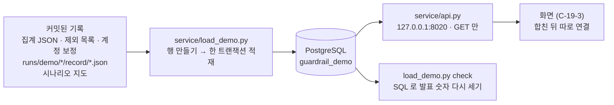

# service — 데모 기록 DB + 조회 API (C-19-6, DM-89)

커밋된 데모 기록(작은 파일)을 PostgreSQL 에 넣고, **읽기 전용** API 로 조회합니다.
서비스 구조("기록 → 저장소 → API → 화면")를 실제로 보여 주는 첫 단계입니다. 발표의 기본은 그대로 정적 화면(C-19-3)이고, DB 서버가 멈춰도 발표는 됩니다.

- 프록시·실행기·판정 코드는 바꾸지 않습니다. 프록시가 DB 에 바로 쓰는 것은 다음 단계입니다 (DM-89 ③)
- **로컬만** : API 는 `127.0.0.1:8020` 에만 엽니다. 인증이 없으므로 외부 공개는 PM 이 따로 정한 뒤 별도 단위로 합니다 (DM-89 ④)
- DB 는 `guardrail_demo` (PM 이 전에 만든 데모 DB 와 따로). 접속은 환경 변수 `GUARDRAIL_DB_URL` 하나로만 받고, 비밀번호는 파일·로그·커밋에 쓰지 않습니다
- narrative · reasoning 내용 · 키는 DB 와 응답에 넣지 않습니다 (`tokens_reasoning` 은 개수). 적재 때와 응답 때 한 번씩 검사합니다
- 숫자는 기록 그대로 넣고 다시 계산하지 않습니다. 발표 숫자는 적재한 행에서 SQL 로 **다시 세어** 집계·최종 보고서와 같은지 확인합니다

## 구조



| 파일 | 하는 일 |
|---|---|
| `schema.sql` | 테이블 4 개 (아래 표). 여러 번 돌려도 안전 (`IF NOT EXISTS`) |
| `store.py` | SQL 한 벌을 PostgreSQL(psycopg)과 오프라인 SQLite 에서 같이 쓰는 층. 모델 문장 필드·키 패턴 검사 |
| `load_demo.py` | `rows` (DB 없이 행 만들기) · `schema` · `load` · `check` (`--offline` 이면 메모리 SQLite) |
| `queries.py` | 확인 쿼리와 API 조회 쿼리. 최종 보고서 4 절 숫자 (`REPORT_SECTION4`) |
| `api.py` | 읽기 전용 조회 API (FastAPI, 프록시와 같은 프레임워크) |
| `test_live_db.py` | 실제 DB 테스트 (따로 실행, `GUARDRAIL_DB_URL` 이 없으면 건너뜀) |

## 테이블

| 테이블 | 한 행 | 주요 열 | 출처 |
|---|---|---|---|
| `scenarios` | 시나리오 하나 (데모 11 + 데이터셋 A-1 계열 4) | `korean_name`, `task_type` (T1·T2·T3·dataset), `variant`, `pair_scenario_id`, `status`, `frozen`, `title` | `scenarios/README.md`, `docs/criteria/demo-final-freeze.json`, `replay.json` 의 `title` |
| `sessions` | 커밋된 데모 세션 하나 (115) | 모드·계획·레인·반복, 계정 이름표와 보정값, 커밋·dirty, 조건군, 종료 사유·분류, step·토큰·크레딧(실측·추정), 첫 STOP step·템플릿·원인 문장, `if_stopped_*`, 교착 시작·지연, `validity` (valid 67 · excluded 30 · not_counted 18), 제외 사유 코드·대체 세션 | `record/demo-summary.json`·`manifest.json`·`replay.json`, 집계 `session_rows` (분류·교착 시작·지연), 제외 목록, 계정 보정 |
| `steps` | 세션의 step 하나 (932) | 역할, 판정 상태 (진전·정체·되돌림·측정 안 됨), 판정 값 (`decision`, `criteria_reason`, `consecutive_steps`), STOP 원인 문장, 테스트 통과 수, step·누적 토큰·크레딧, `judgement_ns`, `facts` (`replay.json` step 그대로) | `record/replay.json`, `record/judgements.json` |
| `aggregates` | 집계 하나 (계획 3 개 묶음) | `plans`, `input_sha256`, `inputs` (읽은 모든 입력 파일의 sha256), `loaded_at`, `body` (집계 JSON 그대로) | `reports/c19/aggregate-main.json` |

`validity` : 집계에 든 세션 = `valid`, 제외 목록(`reports/c18-8/exclusions.json`)이 뺀 세션 = `excluded`, 시험 계획·계획 없는 세션 = `not_counted`. 제외 목록의 31 번째 세션 `445ab1ba` (0 step 중단)는 기록 폴더가 없어 적재되지 않습니다 (DM-82 ②).

## API (`127.0.0.1:8020`, GET 만)

| 경로 | 응답 |
|---|---|
| `/api/summary` | 발표 숫자 (SQL 로 다시 셈 — C-19-3 화면의 `headline` 과 같은 키), 분모·정의가 붙은 발표 줄 5 개, 유효·제외 수, 제외 사유별 수, 판정 시간 p50·p99 |
| `/api/scenarios` | 시나리오 목록 + 유효성·모드별 세션 수 + 집계의 시나리오 표 |
| `/api/sessions` | 세션 목록. 필터 : `scenario_id`, `task`, `task_type`, `variant` (normal·stall·natural), `mode` (observe·block), `validity`, `plan_id`, `plan_kind`, `class` |
| `/api/sessions/{id}` | 세션 하나 (+ 시나리오 한국어 이름·짝) |
| `/api/sessions/{id}/steps` | step 별 구조화 값 = `replay.json` 의 `steps` 그대로 + `judgement` (판정 시간·사유·연속 수) |
| `/docs`, `/redoc` | 자동 API 문서 (발표에서 API 를 보여 줄 화면). 문서 페이지의 화면 파일(Swagger UI·ReDoc)은 브라우저가 `cdn.jsdelivr.net` 에서 받습니다 |

응답 모양은 C-19-3 화면이 읽는 데이터(집계 JSON 의 `headline`, `replay.json` 의 `steps`)에 맞췄습니다. 화면이 API 를 읽게 바꾸는 것은 브랜치를 합친 뒤 따로 합니다.

## 명령

PM 이 순서대로 쓰는 명령은 `reports/c19-6/pm-commands.md` 에 있습니다 (PostgreSQL 켜기 → DB 만들기 → 스키마 → 적재 → 확인 → API → 합치기).

DB 없이 할 수 있는 것 :

```bash
venv/bin/python -B -m service.load_demo rows
```

```bash
venv/bin/python -B -m service.load_demo check --offline
```

오프라인 테스트는 `tests/test_service_demo_db.py` 이고 전체 오프라인 테스트(`tools/run_offline_tests.py`)에 들어 있습니다. PostgreSQL 대신 같은 SQL 을 메모리 SQLite 에서 돌리고, API 는 소켓 없이 부릅니다.

psycopg 는 `requirements.txt` 에 있지만 C 라이브러리 libpq 를 찾아야 합니다. Homebrew 의 PostgreSQL 은 keg-only 라 `DYLD_FALLBACK_LIBRARY_PATH` 로 알려 줍니다 (명령서 참조).
